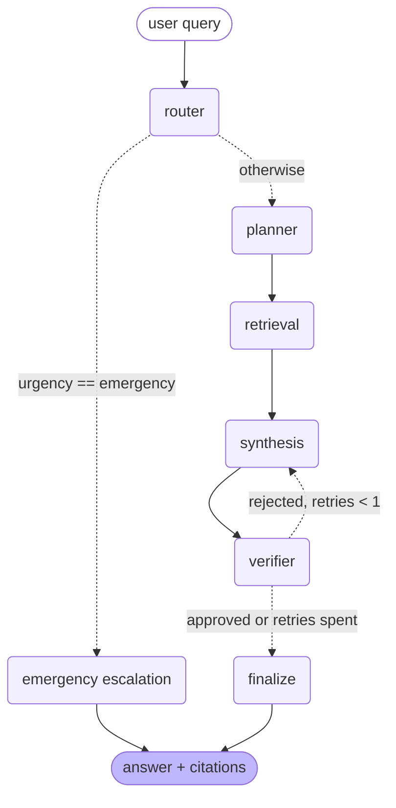
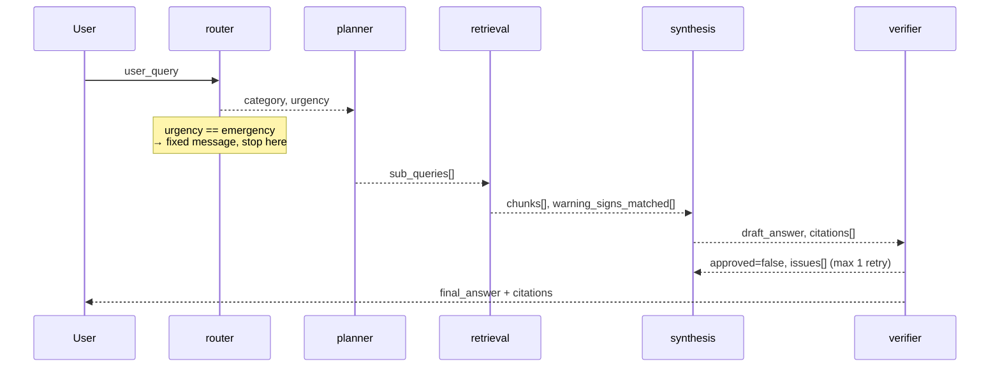

# Dengue Guideline Advisory Agent

A multi-agent, RAG-grounded advisory assistant for dengue guidelines.

> **Decision support only, not a diagnosis.** For urgent symptoms, contact a health
> professional or emergency services immediately.

---

## Project description

Public dengue guidance exists — WHO and national health ministries publish detailed
clinical guidelines — but it is written for clinicians and distributed as long PDFs.
Someone worried about a fever at 2 a.m. is not going to read a 200-page document, and
asking a general chatbot risks a confident answer with no traceable source.

This app answers dengue questions **only** from the official guideline documents it has
ingested, cites the passage behind every claim, and has a second, independent model check
the answer before it is shown. Where the guidelines don't cover something, it says so
instead of filling the gap.

Two safety decisions shape the whole design:

1. **Emergency queries never reach a generation step.** If the router classifies a query
   as an emergency, the app returns a fixed, human-written escalation message. An answer
   that is never generated cannot be hallucinated — and this is exactly the case where a
   hallucination would do the most harm.
2. **Safety invariants are enforced in Python, not in a prompt.** A prompt asking a model
   to always include "seek medical attention" holds most of the time. A code rule holds
   every time. See [src/agents/verifier.py](src/agents/verifier.py).

Intended user: a member of the public or a community health worker who needs to know what
the guidelines actually say. Not a diagnostic tool, and not a substitute for care.

---

## Architecture diagram



Wiring lives in [src/graph/build_graph.py](src/graph/build_graph.py). To regenerate this
diagram from the compiled graph itself:

```bash
python -c "from src.graph.build_graph import build_graph; print(build_graph().get_graph().draw_mermaid())"
```

**The emergency branch** short-circuits before the planner, so it makes exactly one LLM
call — the router — and then returns `config.EMERGENCY_MESSAGE` verbatim.

**The verifier retry** is capped at one. Two models that disagree will keep disagreeing;
an uncapped reflection loop just burns budget. When retries are spent, the answer still
ships, with the unresolved objections attached rather than hidden.

---

## Agentic design patterns used

| Pattern | File | What it does |
|---|---|---|
| **Router** | [src/agents/router.py](src/agents/router.py) | Classifies into `symptom_check` / `prevention_advice` / `reporting_procedure` / `emergency` plus an urgency flag, in JSON mode. Unusable output fails toward escalation; a provider outage raises instead, so downtime is never dressed up as clinical judgement. |
| **Planning / task decomposition** | [src/agents/planner.py](src/agents/planner.py) | Rewrites one question into up to 4 standalone retrieval queries in guideline terminology. The original wording is always kept as an extra query, so a bad decomposition degrades retrieval instead of breaking it. |
| **Tool use** | [src/agents/retrieval.py](src/agents/retrieval.py) | Two tools of deliberately different kinds: fuzzy vector search for finding guidance, and a **deterministic** `check_warning_signs` scan over the structured red-flag list in config. A missed warning sign is this app's worst failure mode, and a string match cannot hallucinate. |
| **Reflection / self-critique** | [src/agents/verifier.py](src/agents/verifier.py) | A *different model from a different vendor* reviews the draft against its cited passages — not the same model grading its own homework. Layered under that, `safety_issues()` applies hard Python rules the model cannot override. |
| **Grounded generation** | [src/agents/synthesis.py](src/agents/synthesis.py) | Answers only from numbered `[S#]` passages, emits "the source documents do not cover this" rather than reaching for parametric knowledge, and never sees an empty chunk list. |

---

## Agent-to-agent communication

Agents never call each other. They read and write keys on one shared `GraphState`
([src/models/state.py](src/models/state.py)), and LangGraph moves the state between them.
Every agent is a plain module-level function, which is what makes them unit-testable
without spinning up the graph.



| Agent | Reads | Writes |
|---|---|---|
| `route_query` | `user_query` | `category`, `urgency` |
| `decompose_query` | `user_query`, `category` | `sub_queries: list[str]` |
| `retrieve_chunks` | `sub_queries`, `user_query` | `chunks: list[{text, source_doc, section, chunk_index, page, score}]`, `warning_signs_matched: list[str]` |
| `synthesize_answer` | `user_query`, `chunks`, `warning_signs_matched`, `issues` | `draft_answer`, `citations: list[str]` |
| `verify_answer` | `draft_answer`, `citations`, `chunks`, `category`, `warning_signs_matched` | `approved: bool`, `issues: list[str]`, `revised_answer: str \| None` |

Full state: `user_query`, `category`, `urgency`, `sub_queries`, `chunks`,
`warning_signs_matched`, `draft_answer`, `citations`, `approved`, `issues`,
`retry_count`, `final_answer`, `trace`.

`trace` is appended to by every node and rendered in the Streamlit sidebar — which agents
fired, in what order, and their key outputs.

---

## Model selection strategy

Two providers, split by what the step costs if it's wrong. Groq handles the mechanical,
high-frequency, on-the-critical-path steps; OpenRouter handles the two steps where a wrong
answer has clinical consequences. All IDs are overridable by environment variable — see
[src/config.py](src/config.py).

| Sub-task | Model (provider) | Why this tier |
|---|---|---|
| **Routing** | `llama-3.1-8b-instant` (Groq) | 4-way classification with a fixed label set, in JSON mode. Nothing else can start until it returns, so latency dominates; reasoning depth is nearly irrelevant. Smallest model that reliably emits the schema. |
| **Planning / re-ranking** | `llama-3.3-70b-versatile` (Groq) | Query rewriting and relevance scoring need more judgement than routing but are still short-form and non-clinical. 70B on Groq is fast and cheap enough to run both, and re-ranking is best-effort — on failure the similarity order is kept. |
| **Synthesis** | `anthropic/claude-sonnet-4.5` (OpenRouter) | The one generation step the user reads. Needs strong instruction-following to hold the "only what's in the passages" constraint under pressure, and a context window big enough for 8 chunks plus the prompt. |
| **Verification** | `google/gemini-2.5-pro` (OpenRouter) | Must be a **different model and a different vendor** from synthesis. Same-family models share training data and failure modes, so a sibling model tends to ratify the same mistakes. Cross-vendor makes the second opinion genuinely independent. |
| **Embeddings** | `all-MiniLM-L6-v2` (local, sentence-transformers) | 384-dim, runs on CPU, no API cost and no per-query network hop — which matters because every sub-query is a separate search. Quality is adequate for a small single-domain corpus; a larger model would be worth it for a broader one. |

**Cost/latency shape:** a normal query makes 4 LLM calls (router, planner, re-rank,
synthesis) plus 1 verification, of which 3 are on the cheap tier. An emergency query makes
exactly 1.

> Model IDs move faster than this file. Verify against
> [Groq's model list](https://console.groq.com/docs/models) and
> [OpenRouter's](https://openrouter.ai/models) before a demo.

---

## RAG pipeline

**Corpus.** Official dengue guideline PDFs in `data/raw/` — WHO dengue guidelines and your
national health ministry's dengue management guidelines. Not committed to git (size, and
they are freely re-downloadable).

**Chunking — heading-aware, not a blind sliding window.**
[src/rag/ingest.py](src/rag/ingest.py) detects the document's own headings first
(numbered sections, ALL-CAPS lines, short title-case lines), then applies a 400-token
window with 50-token overlap *within* each section, never across one.

This is a domain-specific choice, not a default. These guidelines present warning signs
and referral criteria as lists. A window that cuts such a list in half produces a chunk
that reads like a complete answer while silently omitting half the red flags — the kind of
failure that looks fine in a demo and is dangerous in use. There is a test pinning this:
`test_warning_sign_list_is_not_split_across_chunks`.

**Metadata.** Every chunk carries `source_doc`, `section`, `chunk_index`, and `page`. This
is what makes the `[S#]` citations in the answer resolvable back to a real location.

**Embedding and storage.** `all-MiniLM-L6-v2` via sentence-transformers, into a persistent
Chroma collection with cosine distance. [src/rag/vectorstore.py](src/rag/vectorstore.py)
is the only module that loads the embedding model, which is what structurally prevents the
classic RAG footgun: a query embedded with a different model than the corpus returns
neighbours that are nearest in the wrong space, and it fails *silently* — you get
confident, plausible, wrong chunks.

**Query time.** Each sub-query runs its own top-8 search; results are merged, deduplicated
by `(source_doc, chunk_index)` keeping the best score, LLM re-ranked, and the top 8 go to
synthesis.

### Retrieval evaluation

Retrieval is measured on its own, before generation, because a generation-level score
can't tell you whether a bad answer came from bad retrieval or bad synthesis.

```bash
python -m scripts.eval_retrieval
```

Five queries, one per intent the router recognises, scored on hit@8, precision@8, and MRR.
Ground truth is keyword-based rather than hand-labelled chunk ids, so the numbers stay
comparable across re-chunking runs.

| # | Query | hit@8 | precision@8 | MRR |
|---|---|---|---|---|
| 1 | What are the warning signs of severe dengue? | _run to fill_ | | |
| 2 | How much fluid should a dengue patient drink at home? | _run to fill_ | | |
| 3 | How do I stop mosquitoes breeding around my house? | _run to fill_ | | |
| 4 | When must a dengue case be notified to the health authorities? | _run to fill_ | | |
| 5 | Which criteria mean a dengue patient must be admitted to hospital? | _run to fill_ | | |

> **Not yet run** — this table is filled in from the harness output once the corpus is
> ingested. The expected-keyword lists in
> [scripts/eval_retrieval.py](scripts/eval_retrieval.py) must be reviewed against the
> PDFs you actually ingest; they are written against standard WHO terminology.

---

## Setup instructions

```bash
python -m venv venv
```

```bash
venv\Scripts\activate
```

```bash
pip install -r requirements.txt
```

Copy the secrets template and fill in both keys
([Groq](https://console.groq.com/keys), [OpenRouter](https://openrouter.ai/keys)):

```bash
copy .streamlit\secrets.toml.example .streamlit\secrets.toml
```

Put the guideline PDFs in `data/raw/`, then build the index:

```bash
python -m src.rag.ingest --reset
```

Run the app:

```bash
streamlit run app.py
```

Run the tests (no API keys or corpus needed — they cover the deterministic layer):

```bash
python -m pytest tests/ -q
```

Check retrieval quality:

```bash
python -m scripts.eval_retrieval
```

---

## Live demo

<!-- Deploy to Streamlit Community Cloud, add GROQ_API_KEY and OPENROUTER_API_KEY under
     App settings → Secrets, then paste the URL here. Note that ingestion must run on the
     deployed instance too, or chroma_db/ must be committed for that deployment. -->

_Not yet deployed._

---

## Known limitations

- **The corpus is the ceiling.** The app can only say what the ingested PDFs say. Guidance
  that is current practice but absent from the documents will come back as "not found",
  which is honest but not always helpful.
- **Scanned PDFs are skipped.** `pypdf` extracts text, not images. A scanned guideline
  ingests as zero chunks and reports so; OCR is not wired up.
- **Heading detection is heuristic.** It handles numbered sections and CAPS/title-case
  headings. A document with unusual typography will fall back to near-blind windowing
  within whatever sections it did find.
- **Keyword-based retrieval eval.** Cheaper and more stable than human relevance labels,
  but it rewards passages containing the right words over passages that actually answer
  the question. It is a floor, not a quality score.
- **The verifier is a second opinion, not a fact-checker.** It checks the draft against
  the retrieved passages. It cannot catch an error that is faithfully reproduced from a
  passage that was itself the wrong passage to retrieve.
- **No conversational memory.** Each question is routed and answered independently;
  follow-ups like "and for children?" are not resolved against the previous turn.
- **English only.** Both the corpus and the prompts assume English.
- **Not evaluated end-to-end.** Retrieval has a harness; answer quality does not. There is
  no measurement of how often the verifier correctly rejects a bad draft.
- **Not a medical device.** No clinical validation of any kind has been done.
